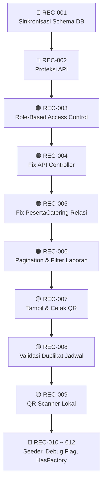

# SPPC — Rekomendasi Perbaikan
**Sistem Presensi & Pengambilan Catering — Pesantren Walisongo**
**Dibuat:** 2026-11-24 | **Berdasarkan:** `discovery-findings.md`

---

> [!IMPORTANT]
> Perbaiki temuan **Critical** dan **High** terlebih dahulu sebelum aplikasi digunakan di production.
> Perbaikan Critical wajib dilakukan sebelum migrate database.

---

## REC-001 — Sinkronisasi Schema Database (Critical — F-001)

### Masalah
Migration dan Model menggunakan nama tabel dan kolom yang berbeda. Database aktual kemungkinan sudah menggunakan skema sesuai Model (revisi 2), tetapi migration file masih versi lama.

### Rekomendasi

**Opsi A (Direkomendasikan): Buat migration baru yang sesuai dengan model aktual**

```php
// database/migrations/2026_11_24_000001_align_schema_with_models.php
// Buat ulang tabel dengan nama dan kolom sesuai Model

// Santri: tabel 'santri', PK 'id_santri', kolom: nama, kelas, asrama
// Catering: tabel 'catering', PK 'id_catering', kolom: tanggal, waktu, menu
// Presensi: tabel 'presensi', PK 'id_presensi', kolom: id_santri, id_catering, status, waktu_scan
// QrCode: tabel 'qrcode', PK 'id_qrcode', kolom: id_santri, kode_qr
// Laporan: tabel 'laporan', PK 'id_laporan', kolom: id_catering, total_hadir, total_tidak_hadir
// PengambilanLauk: tabel 'pengambilan_lauk', PK 'id_pengambilan', kolom: id_presensi, jumlah_lauk
```

**Opsi B: Update Model agar sesuai dengan migration yang ada**
- Ubah `$table`, `$primaryKey`, dan kolom di `$fillable` pada setiap Model
- Lebih aman jika database sudah diisi dengan data

**Langkah Konkret:**
1. Jalankan `php artisan migrate:status` untuk melihat migration mana yang sudah dijalankan
2. Periksa struktur tabel aktual: `SHOW CREATE TABLE santri;` dll.
3. Pilih opsi A atau B berdasarkan kondisi database live
4. Tambahkan index pada foreign key untuk performa query

---

## REC-002 — Proteksi API Endpoint (Critical — F-002)

### Masalah
Semua API endpoint (kecuali `/api/user`) dapat diakses tanpa autentikasi.

### Rekomendasi

Tambahkan middleware `auth:sanctum` pada semua API route:

```php
// routes/api.php

use Illuminate\Support\Facades\Route;
use App\Http\Controllers\SantriController;
use App\Http\Controllers\LaukController;
use App\Http\Controllers\PengambilanLaukApiController;

// Grup dengan autentikasi Sanctum
Route::middleware('auth:sanctum')->group(function () {
    Route::apiResource('santri', SantriController::class);
    Route::apiResource('lauk', LaukController::class);
    Route::apiResource('pengambilan-lauk', PengambilanLaukApiController::class);

    Route::get('/user', function (Request $request) {
        return $request->user();
    });
});
```

**Tambahan:** Buat endpoint login API untuk Sanctum token:
```php
Route::post('/login', [AuthController::class, 'apiLogin']);
```

---

## REC-003 — Role-Based Access Control pada Web Routes (High — F-003)

### Masalah
Semua route hanya dilindungi `auth` (sudah login), bukan per-role. Role `catering` bisa akses CRUD santri.

### Rekomendasi

**Opsi A: Gunakan Laravel Policy / Gate**

```php
// app/Providers/AppServiceProvider.php

use Illuminate\Support\Facades\Gate;

Gate::define('admin-only', fn($user) => $user->role === 'admin');
Gate::define('catering-only', fn($user) => $user->role === 'catering');
Gate::define('pengasuh-only', fn($user) => $user->role === 'pengasuh');
```

**Opsi B: Middleware Custom per Role (lebih eksplisit)**

```php
// app/Http/Middleware/RoleMiddleware.php
public function handle(Request $request, Closure $next, string ...$roles): Response
{
    if (!in_array(auth()->user()->role, $roles)) {
        abort(403, 'Akses ditolak. Role tidak diizinkan.');
    }
    return $next($request);
}
```

```php
// routes/web.php — Pemisahan per role
Route::middleware(['auth', 'role:admin'])->group(function () {
    Route::resource('santri', SantriController::class);
    Route::resource('catering', CateringController::class)->except(['show']);
});

Route::middleware(['auth', 'role:admin,catering'])->group(function () {
    Route::get('/scan', [PengambilanLaukController::class, 'index'])->name('scan.index');
    Route::post('/scan', [PengambilanLaukController::class, 'store'])->name('scan.store');
});

Route::middleware(['auth', 'role:admin,pengasuh'])->group(function () {
    Route::get('/laporan', [LaporanController::class, 'index'])->name('laporan.index');
    Route::get('/laporan/pdf', [LaporanController::class, 'pdf'])->name('laporan.pdf');
});
```

> [!TIP]
> Daftarkan middleware di `bootstrap/app.php` dengan alias: `$middleware->alias(['role' => RoleMiddleware::class]);`

---

## REC-004 — Perbaiki PengambilanLaukApiController (High — F-004)

### Masalah
Controller memanggil relasi `santri`, `catering`, `user` yang tidak ada di Model.

### Rekomendasi

**Opsi A: Tambahkan relasi yang hilang ke Model `PengambilanLauk`**

```php
// app/Models/PengambilanLauk.php

public function santri()
{
    return $this->hasOneThrough(
        Santri::class,
        Presensi::class,
        'id_presensi',  // FK di presensi → pengambilan_lauk
        'id_santri',    // FK di santri → presensi
        'id_presensi',  // PK pengambilan_lauk
        'id_santri'     // PK santri
    );
}

public function catering()
{
    return $this->hasOneThrough(
        Catering::class,
        Presensi::class,
        'id_presensi',
        'id_catering',
        'id_presensi',
        'id_catering'
    );
}
```

**Opsi B: Update controller agar melalui relasi `presensi`**

```php
// PengambilanLaukApiController@index
return response()->json(
    PengambilanLauk::with([
        'presensi.santri',
        'presensi.catering',
    ])->latest('id_pengambilan')->get()
);
```

---

## REC-005 — Perbaiki Relasi PesertaCatering (High — F-005)

### Masalah
Foreign key pada relasi `PesertaCatering::santri()` tidak sesuai.

### Rekomendasi

```php
// app/Models/PesertaCatering.php — Perbaiki relasi

public function santri()
{
    // Gunakan primary key yang benar sesuai Model Santri
    return $this->belongsTo(Santri::class, 'santri_id', 'id_santri');
}
```

Atau jika mengikuti konvensi migration lama:
```php
return $this->belongsTo(Santri::class, 'santri_id', 'idSantri');
```
Pastikan konsisten dengan schema aktual.

---

## REC-006 — Pagination & Filter pada Laporan (High — F-006, Medium — F-010)

### Masalah
Laporan memuat semua data tanpa batasan. Tidak ada filter.

### Rekomendasi

**Tambah filter + pagination di controller:**

```php
// app/Http/Controllers/LaporanController.php

public function index(Request $request)
{
    $query = Presensi::with(['santri', 'catering', 'pengambilanLauk']);

    // Filter tanggal
    if ($request->filled('dari')) {
        $query->whereDate('waktu_scan', '>=', $request->dari);
    }
    if ($request->filled('sampai')) {
        $query->whereDate('waktu_scan', '<=', $request->sampai);
    }

    // Filter sesi
    if ($request->filled('sesi')) {
        $query->whereHas('catering', fn($q) => $q->where('waktu', $request->sesi));
    }

    // Filter asrama
    if ($request->filled('asrama')) {
        $query->whereHas('santri', fn($q) => $q->where('asrama', $request->asrama));
    }

    $laporan = $query->orderByDesc('waktu_scan')->paginate(50);

    return view('laporan.index', compact('laporan'));
}
```

**Tambah filter form di view laporan:**
```blade
<form method="GET" action="{{ route('laporan.index') }}">
    <input type="date" name="dari" value="{{ request('dari') }}">
    <input type="date" name="sampai" value="{{ request('sampai') }}">
    <select name="sesi">
        <option value="">Semua Sesi</option>
        <option value="Pagi">Pagi</option>
        <option value="Siang">Siang</option>
        <option value="Malam">Malam</option>
    </select>
    <button type="submit">Filter</button>
</form>
```

---

## REC-007 — Fitur Tampil & Cetak QR Code (Medium — F-011)

### Masalah
QR code di-generate sebagai string UUID, tetapi tidak ada cara menampilkan atau mencetak QR code visual.

### Rekomendasi

**Install library QR code generator:**
```bash
composer require simplesoftwareio/simple-qrcode
```

**Tambahkan tampilan QR Code di halaman santri:**
```blade
{{-- resources/views/santri/index.blade.php --}}
{!! QrCode::size(100)->generate($santri->qrCode->kode_qr) !!}
```

**Buat halaman cetak QR Card:**
```php
// routes/web.php
Route::get('/santri/{id}/qr', [SantriController::class, 'printQr'])
     ->name('santri.qr')
     ->middleware(['auth', 'role:admin']);
```

```php
// SantriController@printQr
public function printQr($id)
{
    $santri = Santri::with('qrCode')->findOrFail($id);
    return view('santri.qr-card', compact('santri'));
}
```

---

## REC-008 — Validasi Duplikat Jadwal Catering (Medium — F-009)

### Masalah
Tidak ada cek duplikat saat membuat jadwal (tanggal + sesi/waktu bisa sama).

### Rekomendasi

```php
// app/Http/Controllers/CateringController.php@store

$validated = $request->validate([
    'tanggal' => ['required', 'date'],
    'waktu'   => [
        'required',
        Rule::in(['Pagi', 'Siang', 'Malam']),
        // Tambahkan rule unique kombinasi tanggal + waktu
        Rule::unique('catering')->where(function ($query) use ($request) {
            return $query->whereDate('tanggal', $request->tanggal)
                         ->where('waktu', $request->waktu);
        }),
    ],
    'menu' => ['required', 'string', 'max:255'],
], [
    'waktu.unique' => 'Jadwal catering untuk sesi ini pada tanggal tersebut sudah ada.',
]);
```

---

## REC-009 — Pindahkan Library QR Scanner ke Lokal (Medium — F-012)

### Masalah
html5-qrcode dimuat dari CDN — gagal jika offline.

### Rekomendasi

```bash
npm install html5-qrcode
```

Kemudian referensikan dari `vite.config.js` atau copy ke `public/js/`:

```blade
{{-- Ganti CDN dengan local asset --}}
<script src="{{ asset('js/html5-qrcode.min.js') }}"></script>
```

---

## REC-010 — Tambahkan Database Seeder (Low — F-014)

### Rekomendasi

```php
// database/seeders/DatabaseSeeder.php
public function run(): void
{
    // User admin
    User::create([
        'name'     => 'Admin SPPC',
        'email'    => 'admin@sppc.pesantren',
        'password' => Hash::make('password123'),
        'role'     => 'admin',
    ]);

    User::create([
        'name'     => 'Petugas Catering',
        'email'    => 'catering@sppc.pesantren',
        'password' => Hash::make('password123'),
        'role'     => 'catering',
    ]);

    User::create([
        'name'     => 'Pengasuh',
        'email'    => 'pengasuh@sppc.pesantren',
        'password' => Hash::make('password123'),
        'role'     => 'pengasuh',
    ]);
}
```

---

## REC-011 — Set APP_DEBUG=false di .env.example (Low — F-013)

### Rekomendasi

```env
# .env.example
APP_DEBUG=false  # Jangan gunakan true di production
```

---

## REC-012 — Tambahkan HasFactory pada Model Lauk (Low — F-008)

```php
// app/Models/Lauk.php
use Illuminate\Database\Eloquent\Factories\HasFactory;

class Lauk extends Model
{
    use HasFactory;  // Tambahkan ini
    // ...
}
```

---

## 8. PRIORITAS IMPLEMENTASI



### Urutan Sprint yang Disarankan

| Sprint | Rekomendasi | Estimasi |
|---|---|---|
| **Sprint 1 (Wajib sebelum production)** | REC-001, REC-002, REC-003 | 2–3 hari |
| **Sprint 2 (Bugfix fungsional)** | REC-004, REC-005, REC-006 | 1–2 hari |
| **Sprint 3 (Enhancement)** | REC-007, REC-008, REC-009 | 2–3 hari |
| **Sprint 4 (Polish)** | REC-010, REC-011, REC-012 | 0.5 hari |

---

## 9. MATRIKS TRACEABILITY

| Rekomendasi | Finding | Prioritas | Komponen |
|---|---|---|---|
| REC-001 | F-001 | Critical | Migration, Models |
| REC-002 | F-002 | Critical | routes/api.php |
| REC-003 | F-003 | High | routes/web.php, Middleware |
| REC-004 | F-004 | High | PengambilanLaukApiController, PengambilanLauk |
| REC-005 | F-005 | High | PesertaCatering Model |
| REC-006 | F-006, F-010 | High + Medium | LaporanController, laporan/index.blade.php |
| REC-007 | F-011 | Medium | SantriController, views/santri |
| REC-008 | F-009 | Medium | CateringController |
| REC-009 | F-012 | Medium | scan/index.blade.php |
| REC-010 | F-014 | Low | database/seeders |
| REC-011 | F-013 | Low | .env.example |
| REC-012 | F-008 | Low | Lauk Model |

---

*Dokumen rekomendasi ini dibuat berdasarkan `discovery-findings.md` pada 2026-11-24.*
*Semua kode contoh bersifat referensi — sesuaikan dengan schema aktual database setelah REC-001 diselesaikan.*
